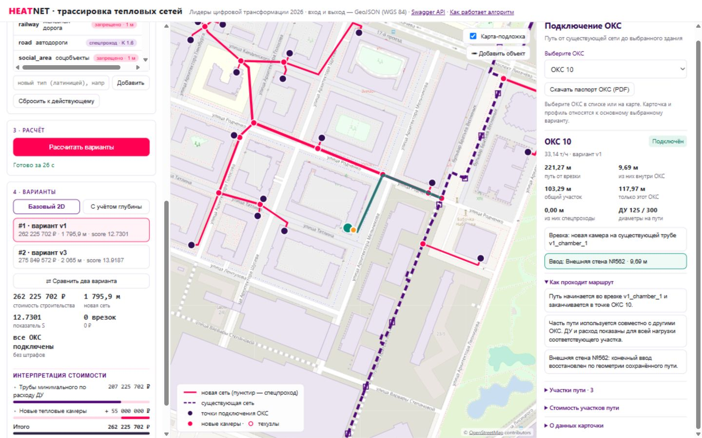
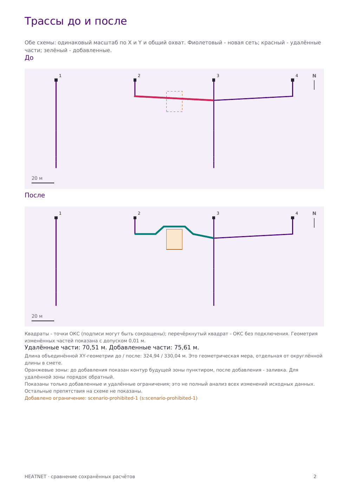
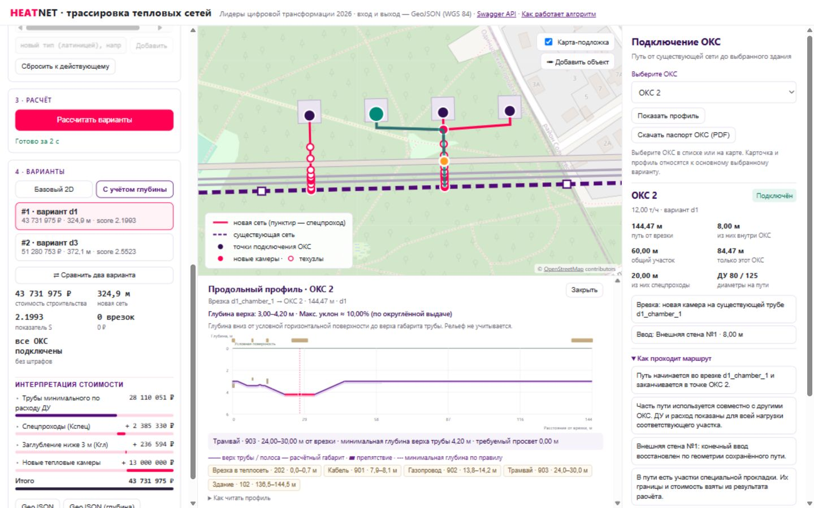

# Сопроводительная документация

**Сервис моделирования трасс подключения к тепловым сетям (HEATNET)**
Конкурсный кейс «Лидеры цифровой трансформации» 2026

Команда **SPATIAL DUET**. Редакция выпуска `geometry-2026-10-20`
от **20 октября 2026 г.** Сервис включает карточку и
PDF-паспорт подключения ОКС, продольный профиль, сравнение двух сохранённых
расчётов в JSON/PDF и отдельная панель подключения рядом с картой.
Инженер может просмотреть врезку, общие участки, стену ввода и глубины,
передать паспорт эксперту и сопоставить решения до и после изменения
ограничений. Эти средства читают готовые результаты; подключения, трассы
и стоимость проверенных расчётов сохранены.

В выпуск входят исправления геометрии от 20 октября: касания границ
полигонов, вход через вершину и разрезы перекрывающихся специальных проходов.
В интерфейсе и пояснительной записке варианты нумеруются по rank;
технические ID сохраняются для API, GeoJSON и воспроизводимого сравнения.

Документ подготовлен по требованиям раздела 5 технического задания:
описание алгоритма, обработка неподключённых ОКС, состав выходных данных,
алгоритм режима с учётом глубины, границы применения решения.

---

## 1. Алгоритм поиска маршрутов и совместного подключения ОКС

### 1.1. Подготовка данных

Входной GeoJSON (FeatureCollection, WGS 84) разбирается потоково — объект за
объектом, без загрузки исходного текста файла в память целиком. Геометрия и
расчётные индексы хранятся в памяти. Spring принимает GeoJSON до 3 GiB,
YAML до 1 MiB, полный multipart-запрос до 3100 MiB; лимит Caddy — 4 GB.
Это параметры приёма, а не подтверждение обработки произвольного
трёхгигабайтного набора.
Каждый объект проверяется на обязательные атрибуты и корректность геометрии;
исправимые дефекты топологии чинятся автоматически, неисправимые приводят к
диагностической ошибке со списком проблем. Все расчёты длин и расстояний
выполняются в метрической проекции EPSG:32637 (WGS 84 / UTM 37N).

Существующий `diameter` поддерживается как целое число 1..1400; для значения
между строками таблицы применяется прежний выбор габарита вверх. Нагрузка
`flow_tph` должна быть конечной и неотрицательной; ноль допустим. Непредставимые
нагрузки, исчезновение положительного значения при переводе в double и
переполнение суммы возможных штрафов отклоняются с диагностикой до расчёта.
Расход выше 22 501,9 т/ч сам по себе не делает GeoJSON ошибочным: такая цель
остаётся неподключённой со штрафом, поскольку таблица не содержит достаточного ДУ.
Для суммы допустимых нагрузок общей ветви проверяется возможность раздельных
присоединений; финальная выдача контролирует расход и непрерывную длину ДУ.

Идентификаторы — строки или точные JSON-числа, уникальные во всём входном наборе.
Числовые 1/1.0/1e0 считаются одним ID, строка "1" — отдельным. Повтор сообщает
обе позиции объектов. Большие целые и точные десятичные ID сохраняют числовой
тип в серверной выгрузке; автоматически создаваемые ID избегают исходных имён.
Эти проверки определяют поддержку входа сервисом, а не вводят новые нормы ТЗ.
При ручном добавлении препятствий веб-интерфейс дополняет исходный JSON без
пересериализации старых чисел; его экранные подписи больших числовых ID могут
округляться средствами JavaScript. Серверные связи и скачиваемый GeoJSON точны.

### 1.2. Модель препятствий

Правила таблицы 2 технического приложения встроены в сервис и могут
расширяться YAML-справочником без изменения кода (новые типы ограничений,
классы дорог, переопределение отступов и коэффициентов).

- **Непроходимые препятствия** (ОКС, парки, соцобъекты, запрещённые
  территории, вода, железная дорога, неизвестные типы — консервативно):
  контур раздувается на минимальный отступ (для ОКС — 5/7/9 м в зависимости
  от ДУ) плюс полуширину расчётного габарита пары труб. Осевая линия новой
  сети не может попадать в эту зону.
- **Специальные проходы** (автодороги, трамвайные пути, газопроводы, силовые
  кабели, пересечение существующей теплосети без врезки): пересечение
  выполняется одним прямым участком; для дорог и трамвая контролируется угол
  не менее 45° к границе; границы спецучастка (по 3 м за границей полигона
  с каждой стороны вдоль трассы либо ±2 м от пересечения линейного объекта)
  обязаны помещаться в один прямой участок —
  повороты внутри спецучастка запрещены; на границах создаются технические
  узлы. При наложении зон применяется максимальный Kспец без перемножения.
  Границы каждого прохода и общего фрагмента сохраняются независимо от
  равенства коэффициентов: меньший Kспец внутри большего также требует разреза.
  Вне специального участка действует обычный отступ по ДУ. Камера на исходной
  теплосети внутри дороги/трамвая допускается по п.13: прямой специальный выход
  продолжается ещё на 3 м вдоль трассы снаружи, запас за камерой не требуется.

Изолированное касание вершины снаружи и движение вдоль границы полигона
не считаются сквозным проходом и не отменяют отступ, в том числе при
`min_angle: 0`. При настоящем входе через вершину угол проверяется к обеим
примыкающим сторонам. Это консервативная трактовка сервиса: ТЗ не задаёт
отдельной формулы для вершины. Касание угла отверстия изнутри материала
дороги, без выхода в отверстие, сохраняет один непрерывный проход.

YAML-пороги `min_distance_by_du` применяются также к специальным препятствиям
и пересечению существующей теплосети: отступ выбирается по ДУ новой трубы,
габарит существующей коммуникации учитывается отдельно. Граница `max_du`
включительна; выше последней границы действует последний отступ. Эти пороги
не меняют `special_margin`. При `k_spec: 1` участок остаётся специальным,
но надбавка Kспец равна нулю; вертикальные условия и Kгл сохраняются.

Загрузчик проверяет YAML до геометрического расчёта: размеры/отступы — конечные
числа ≥0, Kспец ≥1, угол в пределах 0–90°. Числовые строки, `null`, опечатки
в именах полей, повторные ключи и несколько документов отклоняются.
В таблице отступов обязательны неотрицательные `distance`; границы `max_du`
должны быть уникальными положительными целыми int. Строки сортируются;
пустой список явно удаляет унаследованную таблицу. У исходной теплосети
поддерживается только `special`, угол не ограничивается, габарит берётся по ДУ:
положительные `min_angle`/`own_half_width` здесь отклоняются как неподдерживаемые.
Это контракт расширения YAML; он не меняет встроенную нормативную таблицу.

### 1.3. Поиск маршрута

Маршрутизация выполняется по **графу видимости**: вершины — углы раздутых
контуров препятствий (буфер со срезанными углами, предел среза подобран так,
чтобы огибание угла не требовало поворота больше 90°) и промежуточные точки
вдоль рёбер контуров; рёбра — прямые участки, прошедшие геометрическую
валидацию. Поиск — алгоритм A* с мультистартом (несколько допустимых узлов
подхода к точке ОКС) и мультицелевым финишем.

Вес ребра — прямой вклад участка в конкурсный показатель
`S = 0,7·(C/25 млн) + 0,3·(L/100)`: длина, умноженная на стоимость метра
с учётом Kспец, плюс нормированная длина. Терминальная стоимость цели —
стоимость новой камеры или врезки. Таким образом поиск использует целевую
функцию стоимости и длины; окончательный показатель пересчитывается после
сборки всей сети, определения расходов и подбора фактических диаметров.

Точка подключения ОКС лежит внутри полигона здания: строится один финальный
прямой участок от выбранной границы полигона до точки; отступ к собственному
полигону (всем компонентам MultiPolygon) на этот участок не распространяется,
остальные ограничения действуют. Кандидаты узла подхода перебираются по всему
контуру, включая случай точки во внутреннем дворе. Маршрут не должен проходить
через собственное здание до финального ввода. Проверяются нормальные подходы
к стенам, в том числе прямое присоединение к уже построенной сети. Среди
доступных нормальных подходов предпочтителен короткий внутренний участок;
затем ограниченный набор близких стен сравнивается по результату полной сети.
Поэтому выбранная стена не обязательно ближайшая по расстоянию до точки ОКС.

### 1.4. Точки присоединения к существующей сети

- врезка в существующую камеру (5 млн руб.) — если после подключения к ней
  примыкает не более четырёх участков (транзитная линия занимает два примыкания);
- новая камера в произвольной точке существующего участка — стоимость по
  наибольшему ДУ примыканий, включая разрезаемую линию; положение врезки
  уточняется перпендикуляром из последней вершины маршрута. Новая врезка
  на расстоянии ≤10 м от доступной существующей камеры исключается: нужно
  использовать камеру. Это проверяется и после уточнения положения врезки;
- присоединение к уже построенной новой сети (совместное подключение):
  к существующему узлу новой сети или врезкой новой камерой в построенный
  участок.

### 1.5. Совместное подключение и оптимизация

Точки ОКС подключаются последовательно; каждая может присоединиться к уже
построенной сети — так возникают общие магистрали. Жадная вставка
чувствительна к порядку, поэтому совместный вариант строится **семью
детерминированными порядками** (по убыванию расхода, от дальних и от ближних
к сети, четыре фиксированных перемешивания) — берётся лучший. Затем
выполняется **1-opt-улучшение**: каждый ОКС по очереди отключается
(его ветвь вырезается, врезки освобождаются, транзитные камеры склеиваются)
и переприкладывается против итоговой сети; пробы выполняются на копии плана
и принимаются только после полной проверки допустимости с приоритетом
сохранения подключений и улучшения показателя.

При выборе стены дополнительно сравниваются до трёх близких нормальных
вводов с внутренней длиной не более чем на 1 м больше кратчайшей допустимой.
Этот предел относится только к дополнительным пробам и является эвристикой
сервиса, а не нормативом. Другой ввод принимается при сохранении подключений,
строгом уменьшении S и отсутствии роста полной стоимости. Если выгодная
перестройка нарушает стык с соседней ветвью, проверяется совместная перепрокладка
этой пары с теми же условиями приёмки; число вторых перепрокладок ограничено 16
на запуск. Глобальный оптимум стены или сети не гарантируется.

### 1.6. Расходы, диаметры, предельные длины

Расход участка равен сумме расчётных расходов всех ОКС ниже по потоку.
ДУ выбирается по таблице 1: минимальный, удовлетворяющий одновременно
пропускной способности и предельной длине; предельная длина проверяется
отдельно по каждому непрерывному пути «точка подключения → место
присоединения» (общий участок учитывается в каждом пути); по направлению
к месту присоединения ДУ не убывает; камера или технический узел без смены
ДУ новый отсчёт не начинают. После подбора фактических диаметров каждый
участок повторно проверяется на отступы с фактическим габаритом; при
нарушении вариант перестраивается с увеличенным расчётным габаритом.

### 1.7. Варианты и ранжирование

Формируются совместное подключение v1 (выбор из семи порядков построения
и локальное улучшение) и, при наличии содержательно отличающегося решения,
вариант v3 с альтернативными точками присоединения. Дубликаты и варианты,
не прошедшие конечную проверку геометрии, расходов и предельных длин,
отбрасываются; при успешном расчёте
выдаётся один или два базовых варианта, ранжированных по S
(rank = 1 — наименьший показатель). Раздельный independent в основном
расчёте не запускается. В режиме глубины сохраняется соответствие
v1 → d1, v3 → d3; идентификатор не зависит от места в ранжировании.

`variant_id` по формату ТЗ — произвольный идентификатор, а `rank` задаёт
место по показателю S. Для чтения материалов используем «Вариант №1
по рейтингу (ID v1)» либо соответствующие фактические rank и ID.
Технические ID `v1`, `v3`, `d1`, `d3` сохраняются в файлах и API.
Вариант `v3` также может занять первое место; называть его всегда
«вариантом №2» неверно. Нумерация в пояснениях не переименовывает выдачу.

Глубинный профиль дополнительно проверяется по исходным окнам глубины,
минимальному покрытию и предельному уклону 0,10 м/м. Недопустимый глубинный
вариант исключается отдельно, без удаления допустимого базового результата.
Это не заменяет независимую проверку всех вертикальных нормативных условий.

Если исключены все базовые варианты, задача завершается со статусом `ERROR`,
CLI — с кодом 3; недопустимые GeoJSON/PDF не выдаются. Если базовый результат
есть, задача имеет статус `DONE`, а доступность каждого режима отражается
полями `result_available`, `depth_available`, `report_available` в API.
Недоступная выгрузка возвращает HTTP 409 с объяснением.
Причины содержат режим, ID варианта, код, понятное сообщение и ID участков;
они доступны в `diagnostics` статуса задания и файле `*-diagnostics.json`,
а при частичном результате — также в GeoJSON и PDF. Интерфейс показывает
исключённые варианты и отключает недоступный режим глубины.
Отказ не означает доказанной невозможности построить допустимую сеть.

## 2. Обработка ОКС, для которых маршрут не найден

Неподключение допускается только если допустимый маршрут при соблюдении всех
правил не найден: поиск выполняется в две фазы (узкий коридор → полный охват
данных), с мультистартом узлов подхода и резервными стратегиями. Если маршрут
не найден, частичный результат сохраняется полностью: остальные ОКС
подключаются, а идентификаторы неподключённых точек выводятся в сводке
варианта (`unconnected_oks_ids`, тип идентификатора сохраняется как во
входных данных). К итоговой стоимости добавляется штраф
`100 000 000 + 500 000 × G` руб. за каждую неподключённую точку (G — расход,
т/ч). Причины отказов диагностируются в журнале сервиса. Намеренный отказ от
технически доступного подключения не используется: приоритет полноты
подключения выше показателя закреплён в логике выбора вариантов.

## 3. Описание выходных данных

Результат каждого режима — отдельный GeoJSON (FeatureCollection, WGS 84).
Варианты внутри файла различаются `variant_id`; идентификаторы входных
объектов сохраняют исходный JSON-тип.

| object_type | Геометрия | Ключевые атрибуты |
|---|---|---|
| heat_network | LineString | id, variant_id, start_node_id, end_node_id, flow_tph, diameter, length, laying_method (base/special), depth_start, depth_end, cost |
| heat_chamber | Point | id, variant_id, diameter (наибольший ДУ примыканий), cost |
| technical_node | Point | id, variant_id |
| variant_summary | null | rank, construction_cost, chamber_construction_cost, existing_chamber_tie_in_count, existing_chamber_tie_in_cost, unconnected_penalty, calculated_cost, new_network_length, score, unconnected_oks_ids |

`start_node_id`/`end_node_id` ссылаются на узлы, совпадающие с геометрическими
концами LineString (точки ОКС и существующие камеры — по входным id, новые
камеры и технические узлы — по сгенерированным id). Повороты без смены
параметров остаются внутренними вершинами LineString; участки делятся в
камерах, технических узлах и на границах спецучастков. В базовом 2D-режиме
`depth_start`/`depth_end` равны null.

Разные границы проходов не объединяются в один технический узел по старому
миллиметровому допуску: допуск совпадения узлов и минимального фрагмента
составляет 0,000001 м.
Обычная длина участка записывается с двумя десятичными знаками; если так
ненулевой участок округлился бы в ноль, сохраняется точность до шести знаков.
Если округление WGS 84 до девяти знаков совмещает концы микросегмента,
их координаты сохраняются с полной точностью и согласуются по ID со всеми
примыканиями и точечными узлами. Стоимость считается из выгруженной длины.
Глубины по-прежнему округляются до 0,01 м; уклон, вычисленный из их разности
на очень коротком участке, не отражает точный внутренний профиль.

Дополнительно к обязательному составу сервис формирует **пояснительную
записку (PDF)**: сравнение вариантов, карта каждого варианта, структура
стоимости, потабличная разбивка участков и камер, методика расчёта.

Интерфейсы получения результата: REST API (`/api/v1/tracing/jobs` — загрузка,
статус, `/result`, `/result-depth`, `/report`; документация — Swagger UI),
встроенный веб-интерфейс `/ui/`, CLI-режим для запуска без БД.

### 3.1. Карточка подключения и объяснение маршрута

После расчёта выберите вариант и нужный объект в списке **«Подключение ОКС»**
или нажмите его точку на карте. Карточка доступна в режимах **«Базовый 2D»**
и **«С учётом глубины»**. В режиме сравнения она относится к основному варианту.
Выбранный путь выделяется на карте; в глубинном режиме этот же ОКС выбран
и в продольном профиле (раздел 4.1).

На широком экране слева находятся настройки расчёта, варианты, общая смета
и выгрузки; в центре — карта и профиль; справа — отдельная панель
**«Подключение ОКС»** с собственной прокруткой. На узком экране карточка
перемещается под карту, профиль — под карточку; весь интерфейс складывается
вертикально. Смена ОКС обновляет данные без автоматической прокрутки.
Явная кнопка **«Показать профиль»** открывает профиль и приводит к нему.

Карточка показывает статус и нагрузку ОКС, точку врезки в существующую
теплосеть, длину пути, его общую и отдельную части, длину ввода внутри
здания, ДУ и специальные проходы. Врезка обозначает место соединения с
исходной сетью; ей не приписывается роль котельной или ТЭЦ. Раздел
**«Участки пути»** раскрывает длину, диаметр, расход и число обслуживаемых
ОКС для каждого ребра. Общий участок используется несколькими ОКС, включая
объекты с нулевой нагрузкой; его расход и ДУ относятся ко всей нагрузке ветви.

Кнопки **«Врезка»**, **«Ввод»** и элементы раздела **«Как проходит маршрут»**
показывают нужное место на карте. Объяснение содержит факты рассчитанного
пути: где он начинается, какие участки общие, через какую стену входит в
здание и какие препятствия встречает. В глубинном режиме выбор препятствия
также связан с продольным профилем. История отклонённых стен и альтернативных
маршрутов не хранится: карточка не доказывает глобальную оптимальность и
не придумывает причины, по которым движок отказался от другого пути.

**Пример конкурсного ОКС 10, вариант №1 по рейтингу (ID v1).** Нагрузка — 33,14 т/ч, путь от
врезки — 221,27 м, общая часть — 103,29 м, отдельная — 117,97 м. Ввод через
восточную стену занимает 9,69 м внутри здания; на пути используются ДУ 125
и 300. Внутренний ввод и специальные проходы уже включены в общую длину.
Из-за округления сумма частей может отличаться от итога на 0,01 м.



*Рисунок 1. Публичный HTTPS-стенд выпуска reports-2026-10-20: параметры и варианты слева, карта в центре, карточка ОКС 10 справа. Основные показатели приведены в тексте.*

**«Внешняя стена №562»** в этом примере — индекс ребра внешнего кольца
полигона здания, начиная с 1, а не архитектурный номер фасада. Если при
чтении была исправлена геометрия, индекс относится к исправленному контуру.
При неоднозначном здании, нескольких контактах с границей, вводе через
внутренний двор или вершину нескольких стен сервис сообщает, что стену
нельзя однозначно восстановить. Неподключённый ОКС также доступен для выбора:
видны статус и нагрузка, без выдуманных пути или причины отказа. Отсутствие
подключения в результате не доказывает невозможность допустимого решения.

**«Стоимость участков пути» не является ценой отдельного подключения.**
Это сумма сохранённых стоимостей трубных участков, включая общие; камеры
и врезки между ОКС не распределяются. Для ОКС 10 эта сумма — 26 971 304 ₽:
15 495 772 ₽ общих и 11 475 532 ₽ отдельных участков. Складывать суммы
карточек разных ОКС нельзя: общая магистраль будет учтена повторно.

В отдельной учебной сцене с четырьмя ОКС и YAML 4,2 м у ОКС 2 в варианте d1
путь — 144,47 м, общая часть — 60,00 м, отдельная — 84,47 м, ввод — 8,00 м.
Нажатие объяснения трамвайного пересечения выделяет участок на карте и
положение 27 м от врезки на профиле с глубиной 4,20 м. Это демонстрация
связи карточки, карты и профиля, а не результат конкурсного набора.

Карточка читает сохранённые результаты и не запускает новый поиск.
Длины измеряются по геометрии в EPSG:32637; пересечения показывают габариты
препятствий, а не полные окна специальных проходов с запасами. В базовом
режиме эти сведения не описывают вертикальное прохождение; глубины доступны
в профиле. Параметры препятствий берутся из сохранённого YAML задачи и
текущего справочника сервера.

### 3.2. PDF-паспорт подключения ОКС

Кнопка **«Скачать паспорт ОКС (PDF)»** под списком объектов сохраняет
отдельный документ для выбранного варианта и ОКС. При смене объекта или
варианта нужно дождаться новой карточки. В паспорте есть нагрузка, врезка,
длины общей и индивидуальной частей пути, ввод и доступные сведения о стене,
схема маршрута, таблица участков с ДУ, расходами и стоимостью, фактические
объяснения. Схема рисуется без внешней картографической подложки.

Глубинный паспорт дополнительно содержит продольный профиль, глубины,
приблизительные уклоны и таблицу препятствий. Открывать профиль на экране
перед выгрузкой не требуется. Для неподключённого ОКС сохраняются статус
и нагрузка без выдуманного маршрута. Паспорт дополняет общую записку по сети
и позволяет передать сведения о конкретном здании эксперту без доступа к UI.

Экспорт читает готовую трассу и не запускает поиск. Стоимость участков пути
включает общие трубы и не является индивидуальной ценой подключения;
камеры и врезки между ОКС не распределяются. Глубины и уклоны имеют те же
пределы интерпретации, что профиль на экране. API и CLI приведены в разделе 6.

### 3.3. Сравнение двух сохранённых расчётов

Сначала инженер получает два обычных расчёта — например, до и после
добавления запретной зоны. Затем выбирает по одному варианту в каждом
результате. Модуль сравнения читает эти данные и формирует JSON и PDF без
повторного поиска, изменения заданий или пересчёта сметы. Сравнение доступно
через API и CLI; экранное сравнение вариантов одной задачи остаётся отдельной
возможностью интерфейса. Сопоставляются варианты одного режима: base/base
или depth/depth, в том числе с разными ID. Смешение base/depth отклоняется.

Отчёт показывает стоимость строительства, штрафы, итоговую стоимость,
длину сети, S, камеры и врезки; сохранённые, потерянные и восстановленные
подключения; изменения путей, вводов и стен. ОКС связываются по точным
типизированным ID. Добавление или удаление ОКС во входе отделяется от
потери подключения прежнего объекта. Все дельты означают **«после минус до»**.
PDF содержит схемы в одном масштабе и изменившиеся подключения;
полный JSON включает все объекты и геометрии.

**Пример с запретной зоной — отдельная сцена из четырёх ОКС.** В исходном
наборе `samples/scenario-comparison/before.geojson` трамвайное правило YAML
задаёт глубину 4,2 м. В `after.geojson` добавлен один полигон
`scenario-prohibited-1` типа `prohibited_site`, размером 14 × 18 м,
который пересекает прежний путь ОКС 2. Остальные объекты и YAML сохранены.
Это учебный пример, а не конкурсный набор с 17 ОКС.

| Показатель | До | После | Изменение |
|---|---:|---:|---:|
| Подключения, v1 и d1 | 4/4 | 4/4 | Все сохранены |
| Длина сети, v1 и d1 | 324,94 м | 330,04 м | +5,10 м |
| Строительство, v1 | 42 974 655 ₽ | 43 400 658 ₽ | +426 003 ₽ |
| Строительство, d1 | 43 731 975 ₽ | 44 157 978 ₽ | +426 003 ₽ |
| Путь ОКС 2, v1 и d1 | 144,47 м | 149,57 м | +5,10 м |



*Рисунок 2. Страница отчёта сравнения v1: сохранённые расчёты учебной сцены из четырёх ОКС. Красным показаны удалённые части пути, зелёным — добавленные, оранжевым — новая запретная зона.*

В v1/d1 перестроился только путь ОКС 2. Врезка, стена и остальные три пути
сохранились; число новых камер осталось равным трём. Все ОКС подключены,
поэтому штраф равен нулю и итоговая стоимость совпадает со строительной.
Это результат конкретного примера: в v3/d3 той же сцены стоимость снизилась.
Добавленное ограничение может изменить ход эвристического поиска, поэтому
удорожание каждого варианта или глобальная оптимальность не гарантируются.

XY сравнивается в EPSG:32637 с допуском 1 см: перенумерация, направление
и техническое разбиение прежних участков не считаются новой трассой.
Для совпавшего пути дополнительно сравниваются ДУ, способ прокладки,
расход и глубины. При разных путях такое сопоставление атрибутов недоступно,
что явно отмечается; обе последовательности участков остаются в JSON.
Стоимость пути включает общие сегменты и не суммируется по всем ОКС.

Отчёт содержит SHA исходных файлов, результатов и эффективных правил.
Список изменений ограничений показывает добавленные и удалённые ID,
но не полный diff их геометрии, атрибутов или YAML. Сравнение не доказывает
единственную причину изменения, нормативную допустимость или оптимум.
Для воспроизведения нужны исходные файлы, та же сборка и YAML.

## 4. Алгоритм построения маршрута с учётом глубины

Дополнительный режим формирует отдельный набор вариантов и не смешивается
с базовым. Z-координаты входных данных не требуются: поверхность земли
условно горизонтальна, глубины существующих коммуникаций заданы условными
значениями по типам (по умолчанию газопровод — верх габарита 0,4×0,4 м на глубине 2,8 м;
кабель — 0,2×0,2 м на 2,7 м; существующая теплосеть — габарит по таблице 1
на 3,0 м); параметры окон пересечений настраиваются YAML-справочником.
Частичные поля `vertical` наследуют остальные значения; правило
`unknown_default.vertical` действует и для неизвестных типов. Допустимые
значения `crossing` — `under` и `above_or_below`. Числовые поля глубины,
просвета и высоты должны быть конечными и неотрицательными; ошибки значений
останавливают загрузку с указанием типа и поля. Параметр
`heat_network_crossing.vertical.obstacle_top_depth` задаёт единую условную
глубину H верха габарита всей исходной теплосети. Значение H используется
для пересечений и для врезок через существующие камеры или новые камеры
на исходной трубе. Значение по умолчанию 3,0 м соответствует техприложению;
переопределение H через YAML — расширение сервиса. При экспорте и повторной
загрузке YAML оно сохраняется и для `crossing: under`, где `min_top_depth`
отдельно задаёт условие нового прохода.

Врезка моделируется совпадением глубин верхних расчётных габаритов новой и
исходной сети; индивидуальные высотные отметки труб во входной модели не
задаются. Это условная модель сопряжения, а не расчёт конструкции узла для
труб разных ДУ. Уклон 0,10, минимальное покрытие 0,70, обычная глубина новой
сети 3,0 м и порог Kгл 3,0 м остаются прежними. Если H меньше 0,7 м, глубинный
вариант исключается с диагностикой конфликта покрытия и отметки врезки,
допустимый базовый 2D-результат сохраняется.

Вертикальное планирование выполняется вдоль маршрутов, найденных в плане
(техприложение допускает совпадение маршрутов режимов):

1. Каждое пересечение задаёт **окно допустимых глубин** верха габарита новой
   сети: над препятствием или под ним с нормативным вертикальным просветом
   (газ — 0,2 м; кабель и теплосеть — 0,5 м), под дорогой — верх не выше
   1,0 м, под трамваем — 1,2 м. Сначала пробуется проход сверху; если его
   нельзя согласовать с остальным профилем, проверяется разрешённый проход
   снизу для конкретного пересечения.
2. Допустимые прежние профили сохраняются. Для проблемной связной компоненты
   создаётся граф общих узлов и границ исходных окон. Нижние и верхние границы
   глубины распространяются вдоль него с уклоном не более 0,10 м/м. Врезки
   в существующую сеть фиксируются на H; остальные новые камеры и ОКС допускают
   согласованную изменённую глубину. Поэтому рампа может начинаться на
   предыдущем ребре перед новой камерой. Выбирается ближайшая к 3,0 м
   допустимая отметка; между отметками строятся рампы и плато с покрытием
   не менее 0,7 м. Проверяются все выбранные исходные окна, уклоны и
   непрерывность в узлах. Перебор разрешённых сторон пересечений ограничен
   256 наборами на компоненту; при неудаче глубинный вариант исключается
   с явной диагностикой. Это эвристический выбор сторон без гарантии
   глобального минимума стоимости; исчерпание лимита не доказывает
   невозможность вертикального решения на этой XY-трассе.
3. На изломах профиля и в точках пересечения отметки 3,0 м создаются
   технические узлы, участок делится. Заглубление ниже 3,0 м оплачивается
   коэффициентом `Kгл = 1 + 0,10·(h − 3)`; на наклонном участке применяется
   среднее арифметическое значений в начале и конце. Длины и предельные
   длины считаются по горизонтальной проекции.

Выходной файл режима содержит заполненные `depth_start`/`depth_end` (глубина
верха габарита) и отдельное ранжирование вариантов.

### 4.1. Продольный профиль выбранного ОКС

После расчёта включите **«С учётом глубины»**, выберите вариант и нужный ОКС
в списке **«Подключение ОКС»** или нажмите точку ОКС на карте.
Под картой появится путь от врезки в существующую сеть до выбранного здания.
В режиме сравнения профиль относится к основному выбранному варианту.
Для неподключённого ОКС или недоступного глубинного варианта профиль не строится;
интерфейс объясняет причину.

- Наведите курсор на участок графика: соответствующий участок и положение
  курсора выделятся на карте. В подсказке видны расстояние от врезки,
  глубина, ДУ и приблизительный уклон.
- Наведите курсор на выделенную трассу на карте: связанный участок появится
  в профиле. Выбор другой точки ОКС на карте переключает и список, и график.
- Нажмите кнопку препятствия под графиком, чтобы показать его положение
  на профиле и карте. Участки доступны с клавиатуры: Tab выбирает участок,
  Enter показывает его середину, стрелки перемещают позицию.
- Кнопка **«Закрыть»** сворачивает панель, сохраняя карточку подключения;
**«Показать профиль»** открывает её снова и прокручивает страницу к профилю.

Глубина отсчитывается вниз от **условной горизонтальной поверхности до верха
расчётного габарита** новой трубы. Это не абсолютная геодезическая отметка
и не отметка оси трубы; рельеф в данной модели не задан. Расстояния считаются
по горизонтальной геометрии в EPSG:32637. Горизонтальный и вертикальный
масштабы графика различаются, поэтому видимый угол линии не равен уклону.
Уклон рассчитан из уже округлённых глубин экспортного GeoJSON и показан
приближённо; просмотр графика не выполняет новую проверку допустимости.

Полосы препятствий показывают пересечение их физического или расчётного
габарита с трассой, **а не полные окна SPECIAL с нормативными запасами**.
Для дорог и трамвая выводится требование к минимальной глубине; неизвестная
толщина покрытия не изображается как известная геометрия. Врезка обозначена
отдельно: ей не приписывается вертикальный просвет обычного пересечения.

В учебной сцене с четырьмя ОКС профиль ОКС 2 в варианте d1 имеет длину
144,47 м и глубины 3,00–4,20 м. Для этой сцены YAML задаёт под трамваем
минимум 4,20 м. Выбор объяснения **«Путь пересекает габарит: Трамвай · 903»**
в карточке выделяет проход на карте и положение 27 м от врезки в профиле.
Это отдельная демонстрационная сцена, а не конкурсный набор из 17 ОКС.



*Рисунок 3. Публичный HTTPS-стенд выпуска reports-2026-10-20: карточка учебного ОКС 2, карта и продольный профиль; требование 4,20 м взято из YAML этой сцены.*

Профиль только читает уже рассчитанный глубинный вариант. Он не запускает
новый поиск и не меняет подключения, XY-трассы, диаметры, стоимость или
конкурсные выгрузки. Это просмотр результата вертикального планирования,
а не совместная оптимизация XY/Z. Глубины новой сети берутся из сохранённого
GeoJSON; параметры препятствий — из сохранённого YAML задачи и текущих
встроенных правил сервера. Историческая версия встроенных правил отдельно
не сохраняется, поэтому после их изменения подписи препятствий старого
задания могут отличаться от первоначальных.

## 5. Проверенные результаты и границы применения

### 5.1. Результаты текущей сборки

После обратной связи экспертов устранены повторные проходы через собственный
ОКС, расширен выбор внешних стен и исправлены обнаруженные конфликты поворотов,
камер и спецпроходов. Вертикальные профили согласуются через общие узлы сети;
исправлены наследование YAML-правил, отступы по ДУ и глубина исходной сети.
Входные числа и ID проверяются до расчёта, недопустимые варианты получают
понятную диагностику и исключаются из выдачи.

Конкурсный набор — 17 ОКС, суммарная нагрузка 488,7 т/ч:

| Варианты | Подключения | Стоимость, ₽ | Длина сети, м | Новых камер |
|---|---:|---:|---:|---:|
| v1 / d1 | 17/17 | 262 225 702 | 1 795,93 | 13 |
| v3 / d3 | 17/17 | 275 849 572 | 2 064,97 | 12 |

В конкурсном v1/d1 восточный ввод ОКС 10 — 9,69 м; в v3/d3 сохраняется
южный ввод 8,70 м. Снижение v1 на 12 745 976 ₽ получено
относительно промежуточного результата 274 971 678 ₽ после первых исправлений
вводов. Сентябрьская сдача содержала недопустимые проходы, поэтому снижение
стоимости относительно той версии не заявляется.

Свежие CLI-пересчёты 19.10 после проверки границ GeoJSON:

| Набор | Подключения каждого v1/v3/d1/d3 | Стоимость v1, ₽ | Время одного CLI-прогона, с |
|---|---:|---:|---:|
| Конкурс | 17/17 | 262 225 702 | 22,415 |
| Синтетика ×10 | 150/150 | 2 801 031 622 | 47,335 |
| Синтетика ×30 | 400/400 | 7 470 630 450 | 353,104 |

Оба GeoJSON и диагностика каждого набора совпали побайтово с последними
допустимыми результатами до исправления входной валидации. Подключения,
трассы, расходы, ДУ, камеры, вертикальные профили и стоимость сохранены.
Независимые аудиты прежних результатов переиспользованы по SHA совпадающих
входов и выходов; они не называются новыми аудитами.

Времена в таблице — одиночные прогоны проверки корректности, не бенчмарк
и не гарантированное время ответа. Сложный большой расчёт остаётся минутным.
В отдельных парных сериях 17.10 медиана трёх пар на плотной сцене 24 ОКС
снизилась с 99,739 до 16,701 с после исключения обязательного independent;
на сцене дороги с 2049 позициями контура — с 228,750 до 61,005 с после
устранения лишней JTS-операции. В обеих сериях выдача совпала побайтово.
Это разные этапы и сцены, а не общий коэффициент ускорения финальной сборки.

Перед публикацией reports-2026-10-20 выполнены свежие **462 Java-проверки
и 77 JavaScript-проверок без ошибок**. Полный Maven-прогон дал 460 PASS;
два теста с настоящим PostgreSQL затем прошли отдельно с Docker API 1.44.
Изолированный Docker + PostgreSQL 15 проверил расчёты, карточки, профили,
паспорта, сравнения JSON/PDF, UI-ресурсы и OpenAPI.

20 октября по HTTPS независимо проверены **100 карточек и 50 профилей**
трёх новых расчётов: конкурсного набора (17/17 в каждом варианте) и учебной
сцены до/после запретной зоны (4/4 в каждом варианте). Проверены также
шесть GeoJSON, три общих PDF, два паспорта и два сравнения JSON/PDF;
все 12 страниц новых отчётов просмотрены. После чтения отчётов статусы,
файлы и 168 JSON-представлений повторно совпали. Между локальными и Linux
GeoJSON отличаются только CRLF/LF; полные данные результатов сохранены.

Два дополнительных расчёта в реальном браузере подтвердили выбор ОКС
списком, картой и клавиатурой, стену ввода, трамвайное пересечение,
открытие профиля и реальные скачивания паспортов/общей записки.
При ширине 390 px кнопка приводит к профилю, горизонтальной прокрутки
страницы нет; ошибок и предупреждений консоли нет. Новые ×10/×30,
нагрузочные прогоны и отложенные геометрические аудиты не выполнялись.
Обновление настоящих материалов не запускает новых расчётов.

Ранее в локальном Docker с PostgreSQL и Caddy проверены очередь (HTTP 503),
лимит YAML (HTTP 413) и перезапуск: готовое задание DONE и три скачиваемых
файла сохранились побайтово, прерванные задания получили ERROR.

Локальная геометрическая проверка **20.10.2026**: 494 Java и 82 JS PASS.
Один PostgreSQL-класс пропущен из-за недоступного Docker. Шесть новых CLI —
исходная и исправленная сборки на конкурсе, ×10 и ×30 — сохранили все
17/17, 150/150 и 400/400 подключений, длины и цены двенадцати вариантов.
Конкурс и ×10 сохранили оба GeoJSON и диагностику побайтово.
На ×30 у v3/d3 добавлены по два сегмента и технических узла на границах
газового прохода 3661 внутри дорожного 3654; новых камер нет.
Независимо сопоставлены 1600 путей ×30, ДУ/расходы/камеры и 4176 точек
профилей: физическая геометрия сохранена в допуске 2 мм, разница
интерполированных экспортных глубин равна нулю.
Свежий аудит изменённого ×30 прошёл 10/10 групп; новый контроль исходных
границ SPECIAL — 5380 сегментов, 694 окна, 1388 границ без замечаний.
Аудиты конкурса/×10 переиспользованы из свежей проверки исходной сборки
по точному совпадению файлов. Подробный протокол в рабочей области:
`context/geometry-final-checks-2026-10-20/RESULTS.md`.
Это локальная проверка; Docker/PostgreSQL и HTTPS этого кандидата
перед публикацией проверяются отдельно.

### 5.2. Границы модели и дальнейшие работы

- Реконструкция существующей сети и существующих камер не рассчитывается
  (разъяснение организаторов № 14); гидравлический расчёт заменён таблицей
  пропускных способностей и предельных длин.
- Совместное подключение использует несколько порядков жадной вставки и
  локальные перестройки. Глобальный оптимум и близость к нему не доказаны.
- Неизвестные типы ограничений по умолчанию непроходимы с отступом 1 м;
  поведение настраивается через `unknown_default`. Это не гарантия
  корректности на любом произвольном расширении входных данных.
- Проверенные синтетические 150/400 ОКС не подтверждают расчёт всей Москвы,
  обработку произвольного файла 3 ГБ или 50 одновременных пользователей.
  Снижение пикового потребления памяти отложено в пользу скорости.
- Недопустимые повороты, обнаруженные конечным контролем, препятствуют
  выдаче варианта. Адресные проверки касаний вершин полигонов и разрезов
  перекрывающихся спецпроходов выполнены локально 20.10; найденные ошибки
  исправлены. Угол при входе через вершину проверяется консервативно по обеим
  примыкающим сторонам. Это не полная проверка всех возможных геометрий.
- Прокладка вдоль уличных коридоров из OSM остаётся дорожной картой.
  Сейчас дорога во входном GeoJSON — ограничение со специальным пересечением,
  а подложка OpenStreetMap в браузере не влияет на расчёт.
- Глубинный режим не меняет XY-трассу и использует условную горизонтальную
  поверхность и заданные глубины коммуникаций. Полная нормативная
  сертификация не заявляется.
- Адаптация к водопроводу или кабельной сети потребует изменения расчётной
  модели, таблиц и проверок; готовая поддержка других ресурсов не заявляется.

## 6. Интерфейсы и живой стенд

**Адрес стенда:** https://heatnet.85-198-82-32.nip.io/ui/ — доступ через браузер.
Выпуск с паспортом ОКС, сравнением расчётов и отдельной панелью подключения
опубликован и проверен по HTTPS 20 октября 2026 г.
Стенд предоставлен как дополнительная возможность демонстрации: 2 CPU
3,3 ГГц, 4 ГБ RAM, 50 ГБ NVMe. Эти ресурсы и локальные времена раздела 5
не определяют гарантированное время ответа для произвольного набора.

**Встроенный веб-интерфейс** (`/ui/`, доступен и на стенде):

- загрузка входного GeoJSON, сводка входного набора (число зданий, ОКС,
  ограничений) и автоматическое центрирование карты (подложка OpenStreetMap);
- карта вариантов с камерами, техузлами и спецпроходами; переключение
  «Базовый 2D / С учётом глубины», глубины участков в подсказках;
- карточка подключения выбранного ОКС в обоих режимах: статус, нагрузка,
  врезка, длины, общие участки, стена ввода, ДУ, расходы и стоимость участков;
  фактическое объяснение маршрута с переходом к объектам на карте и профиле
  (порядок работы и смысл показателей — раздел 3.1);
- продольный профиль выбранного ОКС: глубины, расчётный габарит, препятствия
  и приблизительные уклоны; выбор ОКС из списка или на карте, подсветка
  участков и положения в обе стороны (порядок работы — раздел 4.1);
- карточка каждого варианта: стоимость, длина, score и «Интерпретация
  стоимости» — раскрываемая декомпозиция цены до рубля (минимальные
  диаметры, магистральные диаметры, спецпроходы, заглубление, камеры, врезки);
- режим сравнения двух вариантов на одной карте с разницей стоимости,
  длины и показателя;
- загрузка YAML и редактор справочника ограничений (формы параметров,
  добавление новых типов) и рисование нового ограничения прямо на карте
  с последующим запуском пересчёта;
- скачивание результатов: GeoJSON (базовый и с глубинами), общая пояснительная
  записка PDF и отдельный PDF-паспорт выбранного ОКС;
- интерактивный разбор алгоритма на живом мини-движке:
  https://heatnet.85-198-82-32.nip.io/ui/algorithm.html.

**REST API** — документация Swagger UI на стенде:
https://heatnet.85-198-82-32.nip.io/swagger-ui.html (жизненный цикл задачи:
загрузка файла → статус → результат / результат с глубинами / PDF-отчёт).
Профиль доступен только для чтения через
`GET /api/v1/tracing/jobs/{id}/profile?variant_id=d1`: без `oks_key`
возвращается список ОКС, с ключом из списка — профиль выбранной цели.
Числовые и строковые ID различаются. Если глубинный результат недоступен
или путь нельзя однозначно восстановить, API сообщает об этом; остальные
результаты задачи остаются доступны.

Карточка доступна через
`GET /api/v1/tracing/jobs/{id}/connection?variant_id=v1` для базового режима
или с `variant_id=d1` для глубинного. Без `oks_key` возвращается список ОКС
со статусом и нагрузкой; с ключом из списка — карточка. Ключ передаётся
с URL-кодированием: например, `oks_key=n%3A10` для числового ОКС 10.
Неподключённый ОКС возвращает HTTP 200 со статусом `unconnected`, неизвестная
задача — HTTP 404, недоступный результат или неоднозначная топология —
HTTP 409 с сообщением. Оба интерфейса только читают сохранённый результат.

**PDF-паспорт:**
`GET /api/v1/tracing/jobs/{id}/connection.pdf?variant_id=v1&oks_key=n%3A10`.
Возвращается `application/pdf` для выбранного ОКС; для профиля используйте
глубинный ID, например `d1`. Обязательный `oks_key` берётся из списка
`/connection` с сохранением числового/строкового типа и URL-кодированием.

**Сравнение двух заданий:** `GET /api/v1/tracing/comparison` для JSON
и `GET /api/v1/tracing/comparison.pdf` для PDF. Передайте четыре обязательных
параметра: `before_job_id`, `before_variant_id`, `after_job_id`,
`after_variant_id`. Оба задания должны иметь статус DONE, выбранные варианты —
один режим. Отсутствующий параметр даёт HTTP 400, неизвестная задача — 404,
недоступные или противоречивые результаты — 409 с объяснением.
Эти выгрузки только читают сохранённые результаты и не запускают поиск.

По умолчанию выполняется один расчёт одновременно, ещё до 100 заданий ждут
в очереди. При отказе приёма в очередь API возвращает HTTP 503 и сохраняет
задание как ERROR. После перезапуска прежние QUEUED/RUNNING получают ERROR
с объяснением: исходные данные нужно отправить заново. Завершённые результаты
сохраняются в постоянных томах. Этот режим рассчитан на один экземпляр
приложения; запуск нескольких реплик с общей БД не поддерживается.
YAML больше 1 MiB отклоняется до создания задания с HTTP 413.

**CLI-режим без БД**, из корня репозитория после `mvn package`:

```bash
java -jar target/heatnet-1.0.0.jar --spring.profiles.active=cli \
     --input=samples/sample-city.geojson --output=result.geojson
```

Параметр `--rules=config/rules-example.yml` добавляет собственный справочник;
без него применяются встроенные правила. На выходе — допустимые базовые
варианты, доступные глубинные варианты, PDF и `result-diagnostics.json`.
Код CLI: 0 — базовый результат доступен, 1 — ошибка загрузки входа или правил,
2 — не указаны вход/выход, 3 — все базовые варианты исключены. Неподключённые
ОКС допустимого частичного результата отражаются в сводке и штрафе.

**Паспорт из готовых файлов без сервера и нового расчёта:**

```bash
java -jar target/heatnet-1.0.0.jar --spring.profiles.active=cli \
     --export-connection --input=in.geojson \
     --result=result-depth.geojson --variant=d1 --oks-key=n:2 \
     --rules=rules.yml --output=passport.pdf
```

`in.geojson`, `result-depth.geojson` и `rules.yml` — файлы одного уже
выполненного расчёта. Для base выберите `result.geojson` и `v1`;
при встроенном справочнике опустите `--rules`. `--output` задаёт новый PDF,
а не исходный результат. Числовой ключ `n:2` и строковый `s:2` различаются.

**Сравнение готовых результатов без нового расчёта:**

```bash
java -jar target/heatnet-1.0.0.jar --spring.profiles.active=cli \
     --compare-results \
     --before-input=before.geojson --before-result=before-result.geojson \
     --before-variant=v1 --before-rules=rules.yml \
     --after-input=after.geojson --after-result=after-result.geojson \
     --after-variant=v1 --after-rules=rules.yml \
     --output=comparison.json --pdf-output=comparison.pdf
```

Здесь также используются уже рассчитанные пары вход/результат и их YAML.
При встроенном справочнике соответствующий параметр rules можно опустить.
Не объединяйте `--export-connection` и `--compare-results`; выходы должны
отличаться от входов. Для сравнения: exit 0 — успех, 2 — некорректные параметры
или противоречивые данные, 1 — ошибка чтения/записи. Полный воспроизводимый
пример и правила интерпретации находятся в `docs/scenario-comparison.md`,
описание паспорта — в `docs/connection-card.md`.

**Репозиторий:** https://github.com/dmitrywalther/heatnet — исходный код и
README с инструкциями; `docker compose up --build` запускает приложение и
PostgreSQL. База хранит задания, статусы, пути к файлам и сводки; геометрия
поступает в GeoJSON. Входные и результирующие GeoJSON, YAML и PDF хранятся
файлами в `HEATNET_STORAGE` (по умолчанию `./data`). Для демонстрации без
внешней БД есть профиль `--spring.profiles.active=demo` со встроенной H2.

Идентификатор выпуска: тег `geometry-2026-10-20`.
SHA-256 JAR:
`864bc6edb5f9b1e52d7adbc303679074bc5dfa1ca1f4ee0db10d94481e040810`.
Данные публикации, точный commit, проверки Docker/PostgreSQL/HTTPS и порядок
отката сохраняются в рабочей области:
`context/geometry-release-2026-10-20/RESULTS.md` и `OPERATIONS.md`.

---

*Стек: Java 11, Spring Boot 2.6.3, PostgreSQL (или встроенная H2 в
демо-профиле), springdoc-openapi 1.7.0, JTS 1.19.0, proj4j 1.3.0,
PDFBox 2.0.31; проверенная сборка Maven, также есть конфигурация Gradle;
развёртывание docker-compose. Подробности запуска — в README репозитория.*
